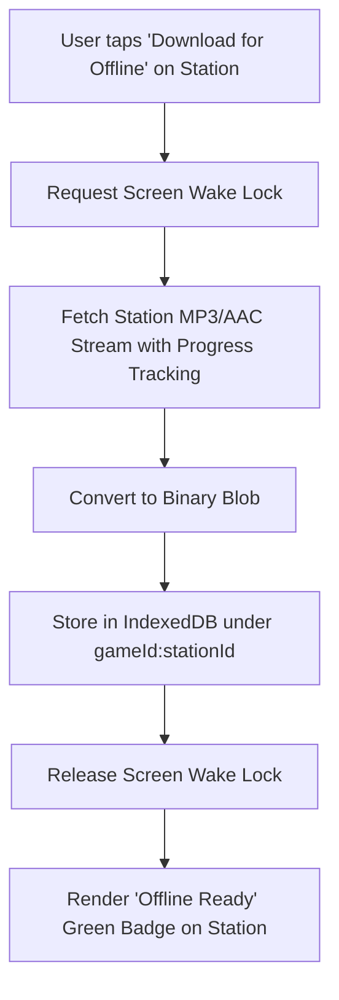

# Architecture & Design Specification: GTA Multi-Game Radio PWA (with Apple CarPlay & Offline Cache)

**Date:** 2026-10-28  
**Status:** Approved  
**Project:** GTA Multi-Game Radio PWA  
**Target Repository:** `/Users/raufaliyev/PersonalProjects/gta-radio-pwa`

---

## 1. Executive Summary & Goals

The goal of this project is to build a standalone, publicly accessible Progressive Web App (PWA) that faithfully recreates the radio experience from the Grand Theft Auto series—spanning **GTA San Andreas**, **GTA IV** (including *Episodes from Liberty City*), and **GTA V**—specifically optimized for mobile browsers, vehicle dashboards via **Apple CarPlay "Now Playing" integration**, and **zero-mobile-data offline commute listening**.

### Why Not Fork `jtaomas/GTA-V-Radio`?
The reference repository [`jtaomas/GTA-V-Radio`](https://github.com/jtaomas/GTA-V-Radio) provides an interactive circular wheel interface for GTA V desktop browsers. However, it suffers from fundamental architectural limitations that make it incompatible with the user's requirements:
1. **Hidden YouTube Iframes (`window.YT.Player`):** YouTube iframes immediately suspend audio playback on iOS mobile Safari when the device locks or backgrounds.
2. **Incompatible with Apple CarPlay:** Third-party iframes cannot route audio to iOS `AVAudioSession`, breaking CarPlay "Now Playing" display, lock screen controls, and steering wheel hardware buttons.
3. **Cannot be Pre-Downloaded or Cached Offline:** YouTube streams cannot be cached into browser storage (IndexedDB / CacheStorage) due to CORS, DRM, and platform restrictions.
4. **Desktop-Only Interaction:** Relies on holding the physical keyboard 'Q' key with mouse coordinates; non-functional on touchscreens without a physical keyboard.
5. **Single-Game Only:** Hardcoded exclusively to GTA V stations without multi-game support.

### The Solution
We engineer a clean, modern, ground-up PWA utilizing:
- **Native HTML5 `<audio playsinline>`** connected to direct audio streams (MP3/AAC) for bulletproof background playback on iOS.
- **W3C Media Session API** deeply integrated with CarPlay's Now Playing screen, Dynamic Island, Lock Screen, and steering wheel buttons.
- **IndexedDB Binary Blob Caching** with the **Screen Wake Lock API** to pre-download stations over home Wi-Fi for 0-mobile-data listening while driving.
- **Epoch-Based Broadcast Simulation** so switching stations feels like tuning into real 24/7 live radio broadcasts mid-stream.
- **Multi-Game Switcher** with authentic game-specific UI themes (San Andreas, GTA IV, GTA V) and a dual-mode interface (Mobile Touch Radial Wheel + Car Quick-Switch Grid).

---

## 2. CarPlay Integration & iOS Audio Lifecycle

### 2.1 CarPlay Platform Architecture
Progressive Web Apps cannot install as standalone native application icons on the CarPlay home screen (which Apple restricts strictly to native Xcode apps with the private `com.apple.developer.carplay-audio` entitlement).

However, an active audio stream from a PWA seamlessly adopts the **CarPlay Now Playing System App** and **Split-Screen Dashboard Card**:
- **Full Display:** CarPlay renders the active station's high-resolution 512×512 station badge, station name, current song title, and artist name.
- **Steering Wheel & Head Unit Controls:** Physical Next/Previous track buttons and rotary dials route hardware commands directly to the PWA.
- **Ecosystem Sync:** Identical metadata and controls simultaneously appear on the iOS Lock Screen, Control Center, Dynamic Island, and Apple Watch.

### 2.2 Background Audio Persistence on iOS 17 / iOS 18+
1. **Native HTML5 Audio Driver:** Audio playback is driven by a single reusable `<audio playsinline preload="auto">` element. Web Audio API `AudioContext` is used exclusively for short UI transition sound effects (tuning static / clicks) because iOS suspends `AudioContext` when locked.
2. **Synchronous Station Switching:**
   CarPlay remote hardware commands (`MPRemoteCommand`) provide a fleeting user-gesture token. In `navigator.mediaSession.setActionHandler('nexttrack')`, the audio controller must synchronously assign `audio.src = nextSource` and trigger `audio.play()` without awaiting asynchronous promises or network calls:
   ```typescript
   navigator.mediaSession.setActionHandler('nexttrack', () => {
     audioManager.playNextStationSync();
   });
   navigator.mediaSession.setActionHandler('previoustrack', () => {
     audioManager.playPreviousStationSync();
   });
   ```
3. **Keep-Alive Protection:** Audio playback transitions are seamless; the audio session is never paused during station hops to prevent iOS from reclaiming audio focus or handing it over to Apple Music.

---

## 3. Storage & Offline Pre-Downloading Engine

### 3.1 IndexedDB Blobs vs. Service Worker Cache Storage
iOS Safari's AVFoundation audio pipeline consistently issues HTTP Range requests (`Range: bytes=0-1`). When Service Worker Cache Storage serves standard full `200 OK` cached responses, iOS Safari frequently throws decode errors and fails to play audio when the screen is locked.

To ensure 100% reliability on iOS:
- Station audio streams are stored as binary `Blob`s in **IndexedDB** (`idb`).
- Playback of cached stations is instantiated via `URL.createObjectURL(blob)`.
- iOS treats blob object URLs as local audio files, executing range requests locally without network dependency or Service Worker header bugs.

### 3.2 Pre-Download Workflow (Wi-Fi Commute Sync)


1. **Screen Wake Lock API (`navigator.wakeLock`):** iOS suspends network requests if the display turns off while downloading large files in Safari. When a download starts, the app requests a Screen Wake Lock to keep the device active until all queued downloads finish.
2. **Granular Storage Controls:**
   - Each station card has a 1-tap download icon showing live percentage progress.
   - Cached stations display a green checkmark indicating zero cellular data usage.
   - Storage Management Drawer displays current usage (via `navigator.storage.estimate()`) and provides per-station deletion as well as a "Clear All Downloads" button.
3. **Storage Persistence:** On startup, the app calls `navigator.storage.persist()`. When added to the Home Screen (`display: standalone`), WebKit exempts the app from the standard 7-day Safari ITP cache eviction.
4. **Offline Resilience:** If the device loses internet connectivity or enters a dead zone while driving, the station switcher automatically restricts navigation to pre-downloaded stations.

---

## 4. Multi-Game Selection & UI/UX Specification

### 4.1 Game Switcher & Visual Design System
The app features a top navigation bar allowing instant switching between three eras of Grand Theft Auto:

| Game | Accent Color | Visual Aesthetic | Font Family | Atmosphere |
| :--- | :--- | :--- | :--- | :--- |
| **GTA V** | `#4ae891` (Emerald) | Sleek modern Los Santos neon | *Oswald*, *Chalet* | Vinewood Hills sunset |
| **GTA San Andreas** | `#f59e0b` (Amber) | 1992 retro West Coast hip-hop | *Pricedown*, *Diploma* | Los Santos golden haze |
| **GTA IV** | `#eab308` (Yellow) | 2008 gritty Liberty City | *Bank Gothic*, Sans | Star Junction industrial slate |

### 4.2 Dual-Mode Interaction

#### Mode A: Interactive Radial Wheel (Optimized for Touch & Desktop)
- **Touch Gesture Support:** Users can touch and drag circularly around the wheel to rotate stations, accompanied by subtle haptic ticks (`navigator.vibrate(10)`).
- **Desktop Keyboard Support:** Users can hold the 'Q' key and move the mouse to scan through stations, or directly click any station badge.
- **Center Broadcast HUD:** Displays the high-resolution station logo, broadcast frequency (e.g. *Space 103.2 FM*), currently playing track, artist name, and DJ/show name.

#### Mode B: Car Quick-Switch Grid (Optimized for One-Hand Driving & Commuting)
- Large, high-contrast touch tiles displaying:
  - Station logo (square 96×96).
  - Station name & genre tagline (e.g., *"West Coast Classics — 90s Golden Age Rap"*).
  - Live "Now Playing" track preview.
  - 1-tap Download / Cached status toggle.
- Simple 1-tap tuning without requiring drag gestures.

### 4.3 Authentic Radio Audio Effects
- **Tuning Static SFX:** A short ~150ms synthesized bandpass-filtered white noise burst plays during station transitions.
- **Switch Click SFX:** Mechanical wheel notch click on every station change.
- **Master Volume & Mute:** Smooth linear-to-logarithmic slider with persistent volume state stored in LocalStorage.

---

## 5. Broadcast Simulation & Track Metadata

### 5.1 Epoch-Based Virtual Live Radio Clock
In the actual GTA games, radio stations broadcast perpetually. To simulate this without maintaining expensive backend servers:
$$\text{elapsed} = \left\lfloor \frac{\text{Date.now()} - T_0}{1000} \right\rfloor$$
$$\text{currentStationTime} = (\text{elapsed} + \text{station.initialOffset}) \pmod{\text{station.duration}}$$

- When a listener tunes into *Non-Stop Pop FM*, they join whatever song or DJ banter is currently scheduled for that second in the broadcast loop.
- The epoch constant ($T_0$) is fixed, meaning all listeners around the world hear the exact same song at the exact same time.

### 5.2 Second-by-Second Track Cue Mapping
Each station contains a comprehensive tracklist mapping time intervals to music, DJ banter, or commercials:
- **Music Playing:** UI and CarPlay display `Song Title` and `Artist Name`.
- **DJ Chatter:** UI and CarPlay display `DJ Host Name` and `Station Name` (e.g. *"DJ Cara — Non-Stop Pop"*).
- **Commercial Breaks:** UI and CarPlay display *"Commercial Break — [Station Name]"*.

---

## 6. Station Lineups & Audio Sources

### 6.1 GTA San Andreas (11 Stations)
1. **Radio Los Santos** (Host: Julio G — West Coast Hip-Hop)
2. **Playback FM** (Host: Forth Right MC — East Coast Classic Hip-Hop)
3. **K-DST** (Host: Tommy "The Nightmare" Smith — Classic Rock)
4. **Radio X** (Host: Sage — Alternative Rock / Grunge)
5. **Bounce FM** (Host: The Funktipus — Funk & Disco)
6. **SF-UR** (Host: Hans Oberlander — House & Acid House)
7. **CSR 103.2** (Host: Phillip "PM" Michaels — New Jack Swing & Pop)
8. **Master Sounds 98.3** (Host: Johnny "The Love Maker" Parkinson — Rare Groove & Soul)
9. **K-Rose** (Host: Mary-Beth Maybell — Classic Country)
10. **K-JAH West** (Host: Marshall Peters & Johnny Lawton — Reggae & Dub)
11. **WCTR** (West Coast Talk Radio — Satirical Talk Shows)

### 6.2 GTA IV & Episodes from Liberty City (19 Stations)
1. **Vladivostok FM** (Host: Ruslana / Vladislav — Eastern European / Dance)
2. **Liberty Rock Radio 97.8** (Host: Iggy Pop — Classic Rock)
3. **The Beat 102.7** (Host: Mister Cee & Green Lantern — Hip-Hop)
4. **Electro-Choc** (Host: François K / Crookers — Electro & Tech House)
5. **Radio Broker** (Host: Juliette Lewis — Indie Rock)
6. **Jazz Nation Radio 108.5** (Host: Roy Haynes — Jazz)
7. **Fusion FM** (Host: Roy Ayers — Jazz-Fusion / Funk)
8. **IF99** (Host: Femi Kuti — Funk / Afrobeat)
9. **Massive B 96.9** (Host: Bobby Konders — Dancehall & Reggae)
10. **Tuff Gong** (Host: Carl Bradshaw — Reggae)
11. **San Juan Sounds** (Host: Daddy Yankee — Reggaeton & Latin)
12. **The Classics 104.1** (Host: Mixed by DJ Premier — Golden Age Rap)
13. **K109 The Studio** (Host: Karl Lagerfeld — Disco)
14. **WKTT (We Know The Truth)** (Conservative Talk Radio)
15. **Public Liberty Radio (PLR)** (Liberal Public Talk Radio)
16. **Integrity 2.0** (Host: Lazlow — Mobile Talk Radio)
17. **Vice City FM** (Host: Fernando Martinez — 80s Pop)
18. **RamJam FM** (Host: David Rodigan — Reggae & Dub)
19. **Self-Actualization FM** (Host: The Futurist — Ambient / Chillout)

### 6.3 GTA V (26 Stations)
Full 26-station roster including *Non-Stop Pop FM*, *Radio Los Santos*, *Los Santos Rock Radio*, *West Coast Classics*, *Space 103.2*, *Rebel Radio*, *Channel X*, *FlyLo FM*, *Worldwide FM*, *Soulwax FM*, *East Los FM*, *The Blue Ark*, *Radio Mirror Park*, *Vinewood Boulevard Radio*, *The Lowdown 91.1*, *The Lab*, *Blonded Los Santos 97.8*, *Los Santos Underground Radio*, *iFruit Radio*, *Motomami Los Santos*, *Kult FM*, *Still Slipping Los Santos*, *The Music Locker*, *WCTR*, *Blaine County Talk Radio*, and *Radio Off*.

### 6.4 Audio Sourcing
Continuous full-broadcast station audio (complete with DJs, jingles, and ads) streams directly from high-speed digital preservation mirrors (Internet Archive audio items and community CDNs) with full CORS and HTTP Range request support.

---

## 7. Data Models & TypeScript Interfaces

```typescript
export type GameId = 'gtasa' | 'gta4' | 'gta5';

export interface TrackCue {
  start: number;
  end: number;
  song: string;
  artist: string;
  type: 'music' | 'talk' | 'ad';
}

export interface Station {
  id: string;
  gameId: GameId;
  name: string;
  genre: string;
  host?: string;
  frequency?: string;
  logoUrl: string;
  audioUrl: string;
  duration: number; // in seconds
  initialOffset: number;
  timestamps: TrackCue[];
}

export interface GameMetadata {
  id: GameId;
  title: string;
  shortTitle: string;
  year: number;
  theme: {
    accentColor: string;
    bgWallpaper: string;
    fontFamily: string;
  };
  stations: Station[];
}

export interface CachedStationRecord {
  stationId: string;
  gameId: GameId;
  blob: Blob;
  sizeBytes: number;
  downloadedAt: number;
}
```

---

## 8. Progressive Web App (PWA) & Deployment Setup

### 8.1 Web App Manifest (`public/manifest.json`)
```json
{
  "name": "Grand Theft Auto Radio Player",
  "short_name": "GTA Radio",
  "description": "Authentic GTA radio player with CarPlay, offline pre-downloading, and full station rosters from SA, IV, and V.",
  "start_url": "/",
  "display": "standalone",
  "background_color": "#0a0a0c",
  "theme_color": "#0a0a0c",
  "icons": [
    { "src": "/icons/icon-192.png", "sizes": "192x192", "type": "image/png" },
    { "src": "/icons/icon-512.png", "sizes": "512x512", "type": "image/png" },
    { "src": "/icons/icon-512-maskable.png", "sizes": "512x512", "type": "image/png", "purpose": "maskable" }
  ]
}
```

### 8.2 Deployment Strategy
The app compiles as a static client-side single page application (`npm run build` producing a `/dist` directory). It has zero server requirements and can be deployed with one click to:
- **Vercel** (`vercel --prod`)
- **Cloudflare Pages** (`wrangler pages deploy dist`)
- **GitHub Pages** (`gh-pages`)

---

## 9. Verification & Testing Strategy

1. **Audio Playback Test**: Verify HTML5 audio streams continuously and does not stop when mobile Safari is placed in the background or the screen is turned off.
2. **CarPlay & MediaSession Test**: Verify `navigator.mediaSession` correctly dispatches station logos, song titles, and artist names, and that Next/Previous hardware commands seamlessly swap stations.
3. **Offline Pre-Download Test**:
   - Download a station over Wi-Fi.
   - Verify IndexedDB contains the valid audio `Blob`.
   - Disconnect Wi-Fi and Cellular (Airplane Mode) and confirm audio plays continuously using 0 bytes of network data.
4. **Responsive UI & Touch Gesture Test**: Test the radial wheel and car grid across mobile viewports (iPhone, Android) and desktop screen sizes.
5. **Multi-Game Switching Test**: Confirm switching between GTA San Andreas, GTA IV, and GTA V updates the theme, stations, logos, and audio seamlessly.
